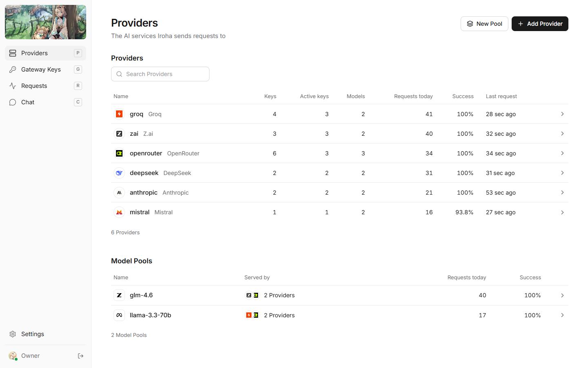
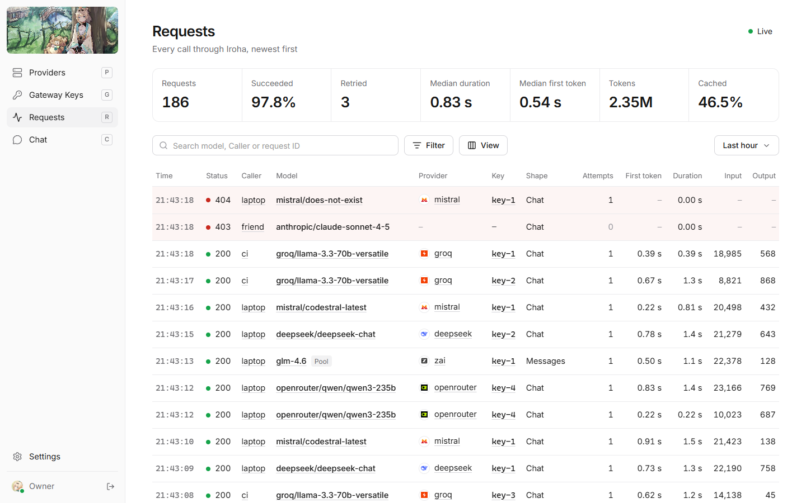
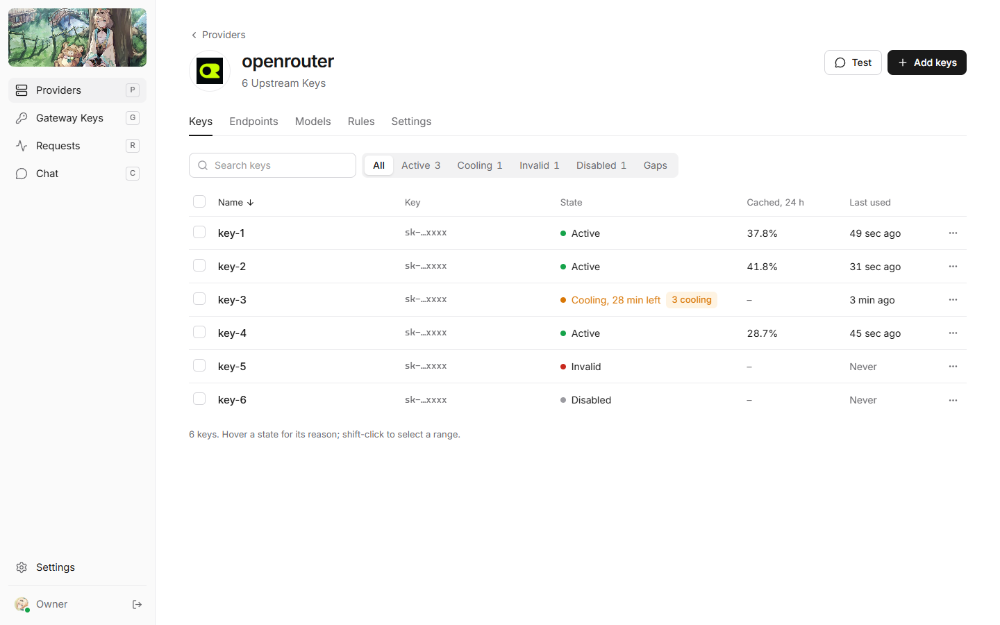
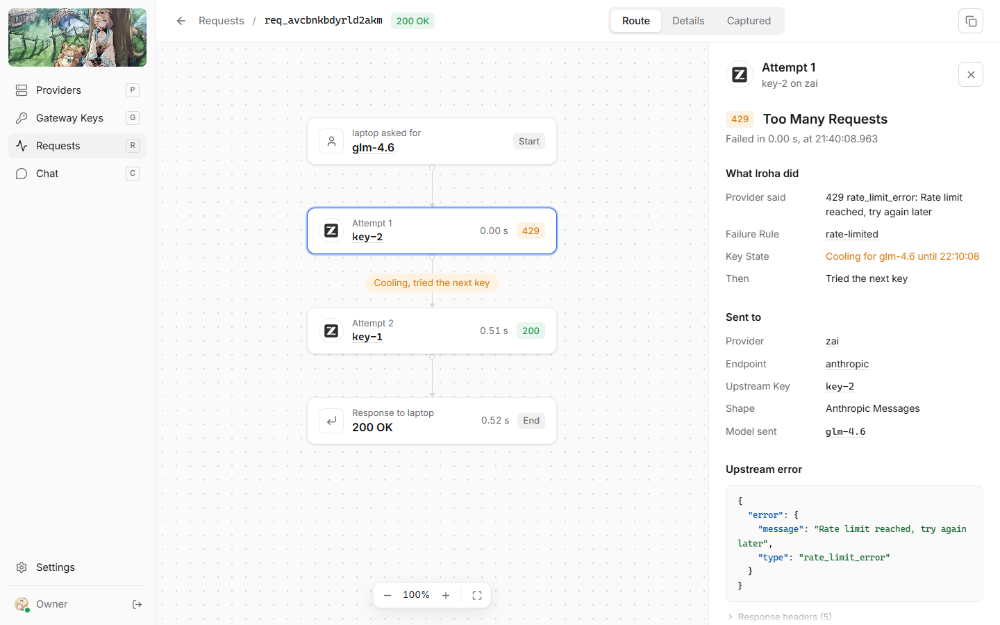

# Iroha

Iroha is a self-hosted AI gateway. It runs as one Go binary with one SQLite file, and its web UI is built into the binary.

The Owner adds AI services as Providers and pastes in their Upstream Keys. Callers, such as apps, friends and agents, then get one base URL and a Gateway Key each. Iroha picks the Upstream Key for every Request, and a Caller never sees an Upstream Key.



## What it does

- Rotates Requests over a Provider's Upstream Keys and keeps each conversation on one key, so the Provider can reuse its prompt cache.
- Tracks a Key State for every Upstream Key: active, disabled, invalid or cooling, with the reason. Failure Rules read each failed response and decide whether the key is invalid, cooling until a known time, or refused one model. Iroha then tries the next key.
- Speaks four Shapes: OpenAI Chat Completions, OpenAI Responses, Anthropic Messages and Gemini. A Caller can use any Shape. When no Endpoint of a Provider speaks it, Iroha translates.
- Serves one model name from several Providers in order with a Model Pool, for failover.
- Limits each Gateway Key to chosen Providers, models and Model Pools.
- Records every Request with its Attempts, token usage and cache reads, and shows the route each Request took.







## Build and run

You need Go and Node 22 or newer.

```sh
npm --prefix web ci
npm --prefix web run build     # builds the UI into internal/webui/dist
go build -o iroha ./cmd/iroha
./iroha --data-dir ./data --addr 127.0.0.1:8080
```

On the first start, Iroha prints a bootstrap Admin Token to its console, once. Open `http://127.0.0.1:8080`, paste that token to set the Owner password, then sign in. `./iroha --help` lists the other flags. Each flag also reads an `IROHA_*` environment variable, for example `IROHA_DATA_DIR`.

## Calling the Gateway

A Caller sends its Gateway Key as a bearer token and names the model as `<provider handle>/<model ID>`, or by a Model Pool name:

```sh
curl http://127.0.0.1:8080/v1/chat/completions \
  -H "Authorization: Bearer $IROHA_KEY" \
  -H "Content-Type: application/json" \
  -d '{"model": "deepseek/deepseek-chat", "messages": [{"role": "user", "content": "Hi"}]}'
```

`/v1/messages` and `/v1/responses` work the same way. `GET /v1/models` lists the models the key may use. Each Provider also has its own base URL, `/providers/<handle>/v1`.

## Agents manage Iroha

The web UI is one client of the admin HTTP API. Agents use the same API with an Admin Token. The running Iroha serves its own instructions at `/skill.md` and the full contract at `/api/openapi.json`, so both match the version that is running. Every change can be a dry run, and Iroha records each change as an Audit Entry that can be reverted.

## More

- `GLOSSARY.md` defines the terms used here.
- `internal/api/skill/` is the source of `/skill.md`, the operating guide.
- `docs/agents/architecture.md` is the package map, for people changing the code.
- `docs/adr/` records the design decisions.
- `deploy/` holds the deploy script and the systemd unit. The runbook is the "Deploying Iroha" section of `/skill.md`, and `deploy/deploy.sh --help` lists the options.

## License

AGPL-3.0. See `LICENSE`.
